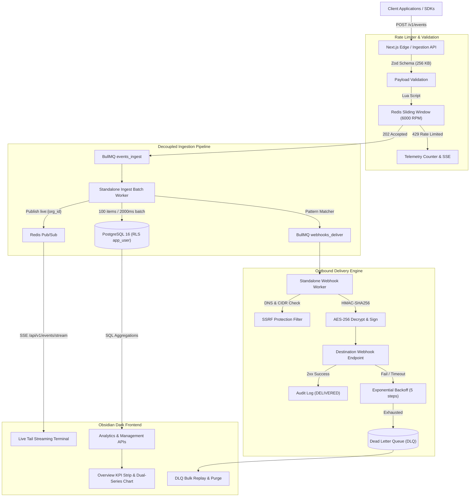

# Multi-Tenant Event Analytics & Webhook Platform

High-throughput event ingestion and cryptographically signed outbound webhook delivery with PostgreSQL Row-Level Security and an Obsidian Dark developer console.

## Architecture & Features

I designed and engineered this platform to bridge high-velocity event ingestion (Mixpanel/PostHog patterns) with reliable, cryptographically authenticated outbound webhook delivery (Svix patterns), strictly adhering to an Obsidian Dark + Surgical Crimson design system.

- **Non-Blocking Ingestion Pipeline**: Ingress routes (`POST /v1/events` and `POST /v1/events/batch`) return `HTTP 202 Accepted` in sub-10ms. Payloads are validated against strict Zod schemas with a 256 KB per-event cap.
- **Atomic Lua Sliding-Window Rate Limiting**: Built an atomic Redis Lua sliding-window rate limiter providing accurate per-organization quotas (default 6,000 RPM) with deterministic `X-RateLimit-*` headers and drop telemetry.
- **Decoupled Persistence & Batch Worker**: Implemented a standalone BullMQ batch worker (`src/workers/ingest-worker.ts`) that drains an in-memory buffer on 100 events or 2,000ms intervals, inserting parameterized multi-row SQL batches to eliminate per-request database lock contention.
- **PostgreSQL 16 Multi-Tenant RLS Defense-in-Depth**: Enforced tenant isolation via PostgreSQL Row-Level Security on every table (`organizations`, `users`, `api_keys`, `events`, `webhook_endpoints`, `webhook_deliveries`, `webhook_attempts`). Application transactions set `app.current_org_id` through a dedicated non-superuser `app_user` connection pool.
- **HMAC-SHA256 Webhook Dispatch & SSRF Shield**: Webhook deliveries are signed using HMAC-SHA256 (`X-Webhook-Signature: t=...,v1=...`) with encrypted AES-256-GCM signing secrets. Outbound requests pass through an active SSRF filter blocking private/loopback CIDRs (`127.0.0.0/8`, `10.0.0.0/8`, `192.168.0.0/16`, `172.16.0.0/12`, `169.254.169.254`, `::1`) with DNS rebinding defenses.
- **Exponential Backoff & Dead Letter Queue (DLQ)**: Failed webhook attempts retry automatically across 5 exponential steps (0s, 10s, 60s, 300s, 1800s ±15% jitter). Exhausted retries transition to DLQ state with manual and bulk replay capabilities.
- **SSE Live Tail & Real-Time Telemetry**: Real-time ingress stream powered by Redis Pub/Sub (`live:{org_id}`) and Server-Sent Events (`/api/v1/events/stream`) with automatic keepalive heartbeats and zero connection leakage on client abort.
- **Obsidian Dark Developer Interface**: Custom UI built on Tailwind CSS v4 design tokens (`bg-canvas`, `bg-surface`, `bg-elevated`, `bg-inset`, `text-ink`, `text-crimson`), featuring a dual-series Recharts volume chart, 540px slide-over Payload Inspector Drawer, 480px one-time API key reveal modal, and full keyboard shortcuts (`⌘K`, `/`, `J`/`K`, `X`, `Enter`, `G` chords).



## Trade-offs & Known Limitations

I opted for BullMQ backed by persistent Redis 7 rather than managed Upstash Redis to prevent rate limit quota exhaustion caused by persistent worker polling loops. Ingested events are buffered in memory up to 100 items or 2,000ms before batch insertion; while this yields sub-10ms ingress responses and minimizes database round-trips, an abrupt worker crash without draining could theoretically drop in-flight buffered records—mitigated here by BullMQ job persistence, Redis Lua rate counter tracking, and clean `SIGTERM`/`SIGINT` draining handlers. Past 50,000 events per second, I would swap BullMQ for an Apache Kafka or Redpanda partitioned event log, utilize ClickHouse or TimescaleDB for multi-billion row event analytical rollups, and scale the outbound HTTP dispatchers as a distributed cluster of Go-based worker pods with local connection pooling.

## Local Setup

### Prerequisites
- Node.js 20+
- Docker & Docker Compose
- npm

### 1. Clone & Configure
```bash
git clone git@github.com:Astral-mk4u48/multi-tenant-event-analytics.git
cd multi-tenant-event-analytics
cp .env.example .env
```

### 2. Boot Local Infrastructure
```bash
docker compose up -d postgres redis
```

### 3. Install Dependencies & Migrate Database
```bash
npm install
npm run db:migrate
npm run db:seed
```

### 4. Start the Application & Workers
In separate terminals (or managed via PM2):
```bash
# Terminal 1: Next.js Frontend & API Routes
npm run dev

# Terminal 2: Ingestion Batch Worker
npm run worker:ingest

# Terminal 3: Webhook Delivery Worker
npm run worker:webhook
```

### 5. Running Tests & Benchmarks
```bash
# Run complete Vitest suite (RLS, Ingestion, Webhooks, Analytics)
npm run test

# Run k6 Ingestion Load Benchmark
k6 run tests/load/ingest.js
# Or with Docker:
docker run --rm -i --network=host grafana/k6 run - < tests/load/ingest.js
```

## Deployment

- **Production Frontend & API**: [https://multi-tenant-event-analytics.vercel.app](https://multi-tenant-event-analytics.vercel.app)
- **Health Check Endpoint**: [https://multi-tenant-event-analytics.vercel.app/api/healthz](https://multi-tenant-event-analytics.vercel.app/api/healthz)
- **Background Daemons**: Standalone workers (`astral-analytics-ingest` and `astral-analytics-webhook`) run persistently on `astral-node` via PM2.

## License

MIT © Pavan (@Astral-mk4u48)
